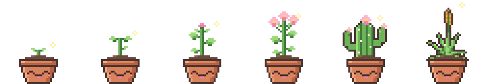

# Desk Pet

A little pixel-art plant that lives on your Mac desktop and grows with your
GitHub contributions. It starts each week as a seed and blooms as you commit,
open pull requests, review and file issues.



## Install

Works on any Mac (Apple Silicon or Intel).

1. Download **`DeskPet-<version>.dmg`** from the
   [latest release](https://github.com/MariaC27/desk-pet/releases/latest).
2. Open it and drag **Desk Pet** into **Applications**.
3. Open Desk Pet from Applications. The first time, macOS blocks it, because
   the app isn't from a paid Apple developer account:
   1. In the "Desk Pet Not Opened" message, click **Done**.
   2. Open **System Settings → Privacy & Security** and scroll down to
      **Security**. Next to "Desk Pet was blocked…", click **Open Anyway**.
   3. Click **Open Anyway** again and enter your Mac password.

   You only need to do this once. Updates install without it.

4. Follow the setup:
   - **Connect GitHub.** Desk Pet shows a short code. Enter it on the GitHub
     page that opens and approve. It can only read your profile and
     contribution counts, not your code.
   - **Pairing code (optional).** Only if someone gave you one. Skip it
     otherwise; everything else works without it.
   - **Pick your plant**, its size, and whether it opens at login.

## Using it

- **Growing:** the plant grows with this week's contributions and resets to a
  seed every Saturday night at midnight (local time). How much it takes to
  reach full bloom is based on your own last 24 weeks, so a quiet week and a
  busy week both feel right. It checks GitHub every few minutes.
- **Move it:** drag the plant anywhere on your screen.
- **Click it:** opens any notes waiting for you. **Double-click** opens the
  tracker with your week and contribution graph. **Right-click** for the menu.
- **Menu bar:** the little potted plant icon has everything: show/hide the pet,
  the tracker, Sync Now, Settings and Quit.

  > Don't see the icon? On MacBooks with a notch, macOS hides menu-bar icons
  > that don't fit. Hold **⌘** and drag other icons around to make room, or
  > find Desk Pet's icon on an external display's menu bar and ⌘-drag it to the
  > right.

### Notes

If someone paired your plant with a code, they can send you little notes and
feelings. A feeling shows on the plant's face until you click it. A note shows
an envelope; click the plant to read it. Past notes stay in the tracker's
**Messages** tab.

### Updates

When a new version is out, Desk Pet lets you know with a notification and an
**Update Available** item in the menu. Nothing installs on its own. Go to
**Settings → App → Install & Restart** when it suits you.

After an update, macOS may ask for your password once so Desk Pet can read its
saved GitHub sign-in from the Keychain. Enter it and choose **Always Allow**.

### Quitting and removing

- **Quit:** menu-bar icon → **Quit Desk Pet** (⌘Q), or Settings → App.
- **Stop it opening at login:** turn off **Open at Login** in the menu or in
  Settings.
- **Uninstall:** quit it, then drag Desk Pet from Applications to the Trash.
  To also revoke its GitHub access, go to GitHub → Settings → Applications →
  Authorized OAuth Apps.

## Privacy

- Desk Pet talks to **GitHub** (your contribution counts) and, only if you
  paired it, to the notes server. Nothing else is collected or sent anywhere.
- Your GitHub sign-in is stored in the macOS **Keychain**, not in a file.
- The GitHub permission is `read:user`: your profile and contribution counts.
  It can't see or change code.

## Development

```
app/        macOS app (Tauri 2 + React + TypeScript)
sender/     private web page for sending notes (Vite + React, on Vercel)
supabase/   database migrations and Edge Functions for notes
```

Requires Node 22+ and Rust (`rustup`).

```sh
cd app
npm install
npm start          # dev app (separate "Desk Pet Dev" identity, menu-bar only)
npm test           # growth/week-boundary tests
npm run sprites    # render every plant, stage, mood and emotion to sprites.png
npm run icons      # regenerate the tray + app icons
```

In dev, the menu-bar icon has a **Dev Panel** entry for testing any stage,
mood, emotion or overlay without waiting for real activity.

### Releasing

Builds are signed with a self-signed "Desk Pet Signing" certificate (so the
Keychain recognizes updates) and an update key at `~/.tauri/desk-pet.key`.

1. Bump `version` in `app/src-tauri/tauri.conf.json`, `app/package.json` and
   `app/src-tauri/Cargo.toml`.
2. `cd app && npm run release -- "What's new"` builds a universal `.dmg`, the
   signed update bundle and `latest.json` into `app/release/<version>/`.
   (`--local` makes a test build that looks for updates at
   `http://localhost:8765` instead.)
3. Publish with the `gh release create …` command it prints. Installed apps
   find the update through
   `releases/latest/download/latest.json`.

### Notes backend

Messages go through Supabase. Only the sender's account can create recipients,
pairing codes and messages (sign-ups are disabled). The app only uses two Edge
Functions, `pair` and `messages`, authenticated by a per-device secret. See
[PLAN.md](PLAN.md) for the full design.
